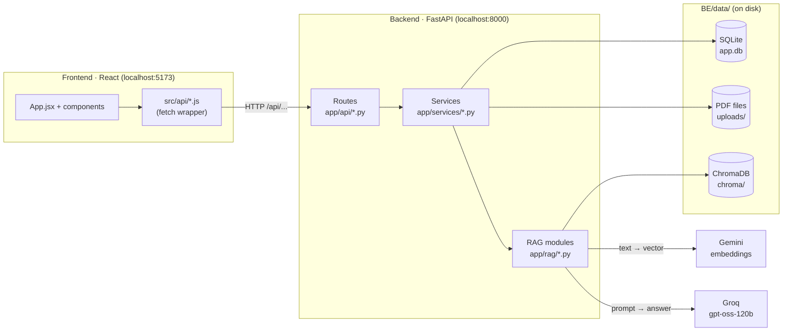
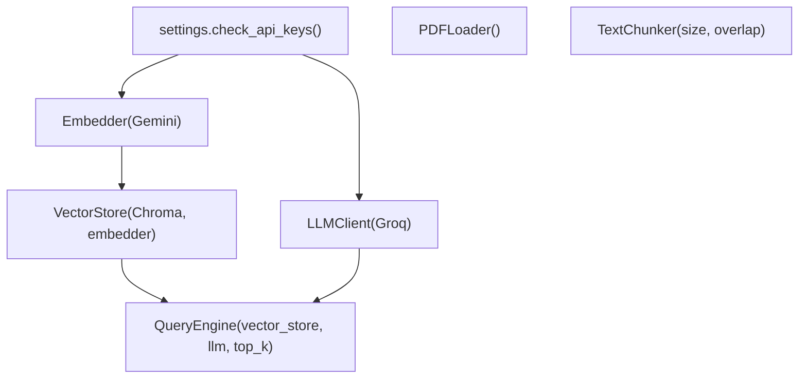
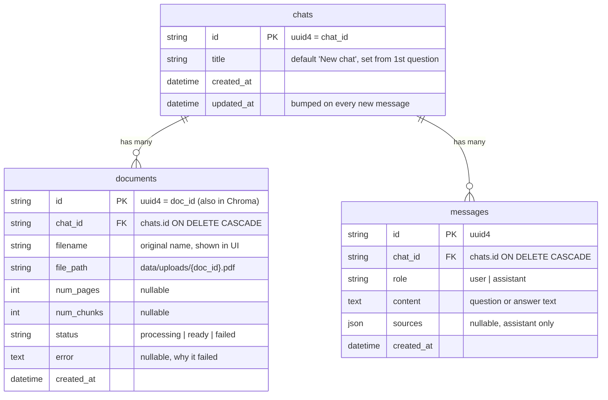
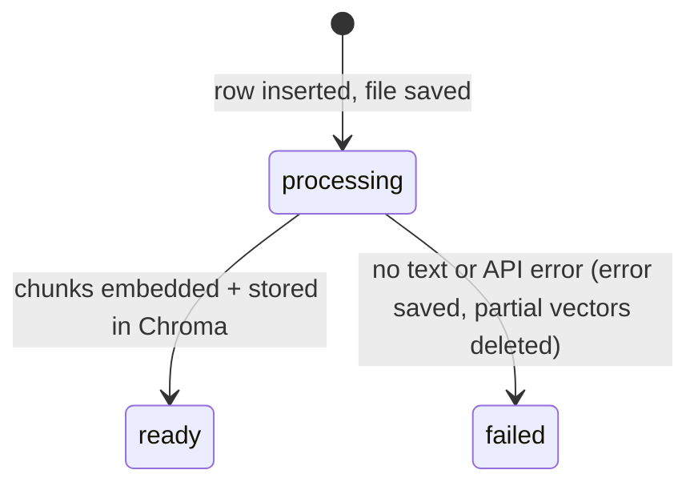
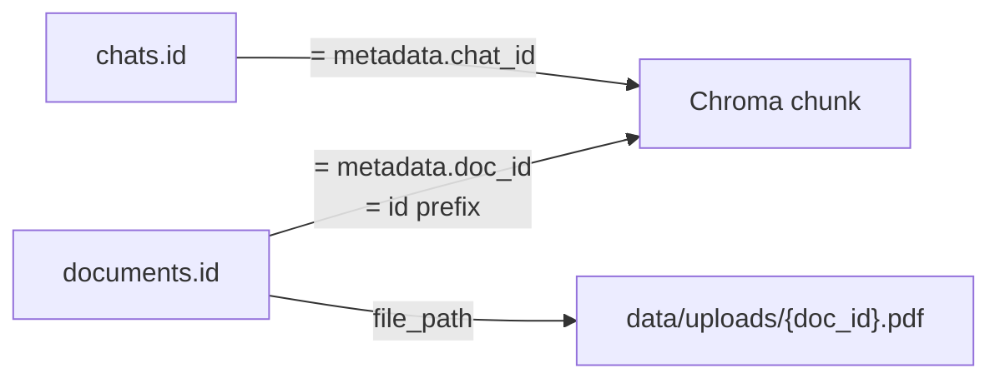
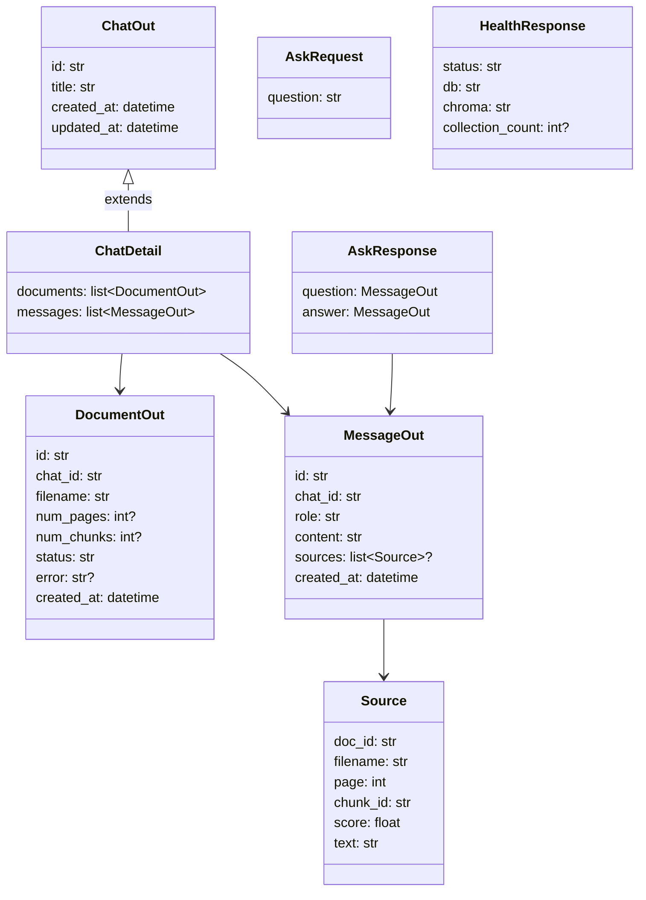
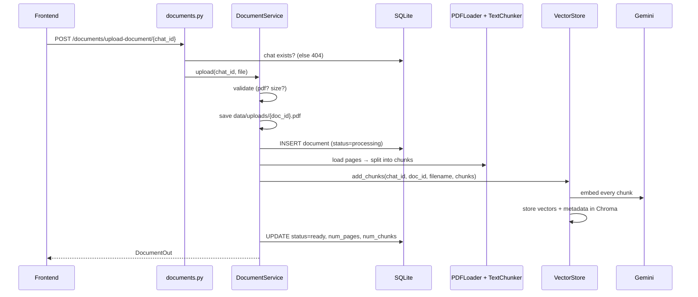
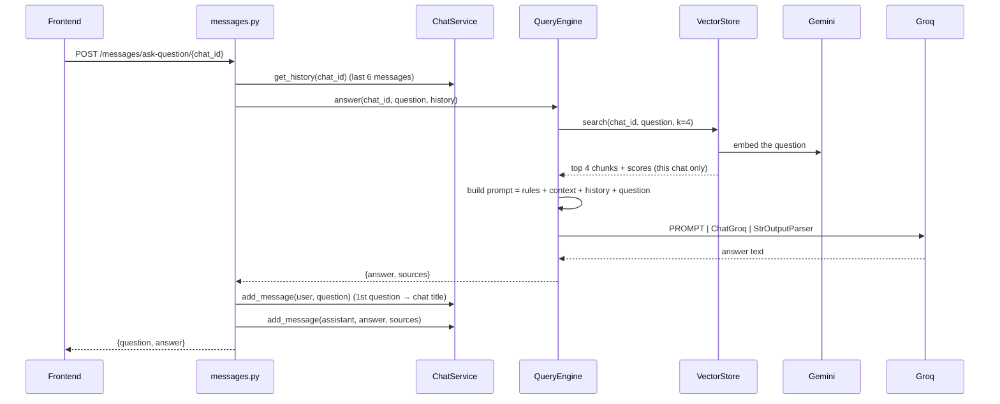
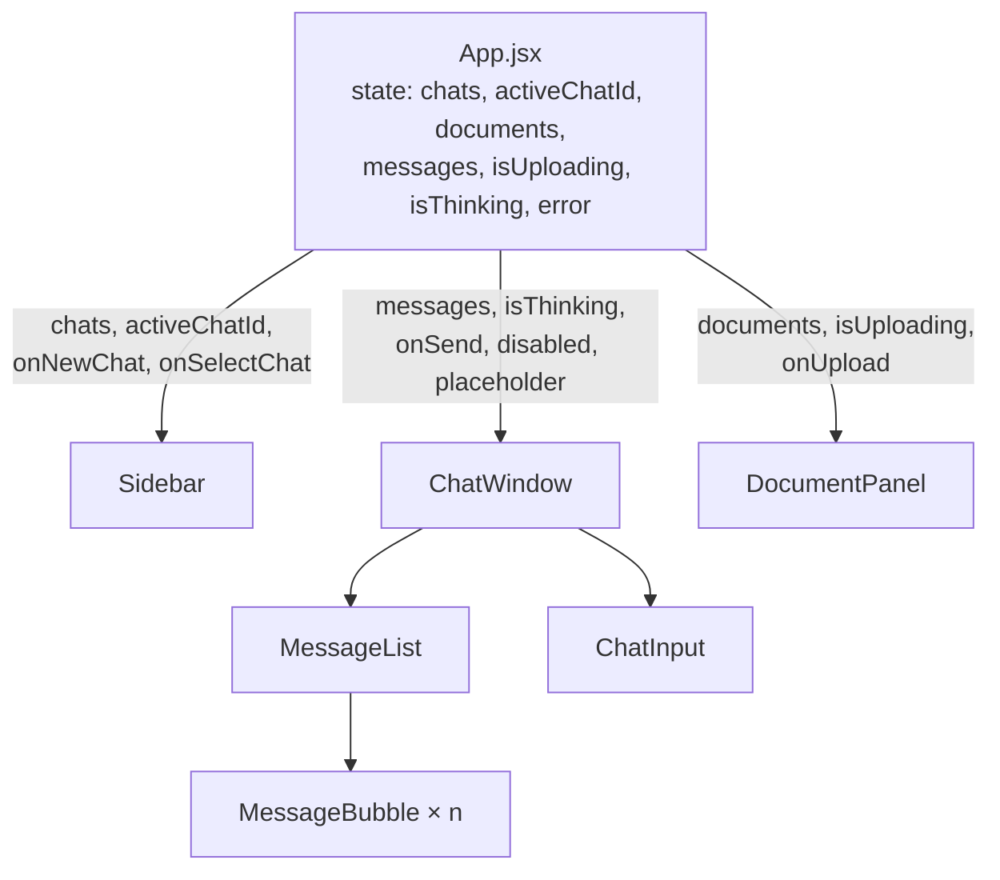

# Docie Talkie: API and Schema Guide

This guide explains how the backend (FastAPI) and frontend (React) fit together: what each file does, what every API endpoint takes and returns, and how the data is stored in SQLite and ChromaDB.

> The diagrams use **Mermaid**. They render on GitHub and in VS Code's Markdown preview. In VS Code you may need the "Markdown Preview Mermaid Support" extension.

---

## 1. The big picture



**One sentence per layer:**

| Layer | Job |
|---|---|
| **Routes** (`app/api/`) | Receive HTTP requests, check the input, call a service, return JSON. Contain no real logic. |
| **Services** (`app/services/`) | Business logic: save chats and messages, handle uploads. They talk to SQLite. |
| **RAG** (`app/rag/`) | The AI part: read PDFs, split them into chunks, embed and store vectors, search them, ask the LLM. |
| **Data** (`BE/data/`) | SQLite for chats, documents and messages. Chroma for vectors. A folder of the original PDFs. |

---

## 2. Backend files

```
BE/
├── .env                     API keys + settings (not in git)
├── alembic/versions/0001_initial_schema.py   creates the SQLite tables
└── app/
    ├── main.py              creates the FastAPI app, builds shared objects at startup, adds CORS
    ├── config.py            Settings class: reads .env, resolves paths, checks API keys
    ├── schemas.py           Pydantic models: the exact JSON shape of every request and response
    ├── dependencies.py      hands each route the service objects it needs
    ├── db/
    │   ├── database.py      SQLite engine, sessions, foreign keys ON, get_db()
    │   └── models.py        ORM tables: Chat, Document, Message
    ├── api/
    │   ├── health.py        GET  /api/check-health
    │   ├── chats.py         /api/chats/create-chat, list-chats, get-chat/{chat_id}
    │   ├── documents.py     /api/documents/upload-document/{chat_id}, list-documents/{chat_id}
    │   └── messages.py      /api/messages/ask-question/{chat_id}, list-messages/{chat_id}
    ├── services/
    │   ├── chat_service.py      ChatService: chats + messages in SQLite
    │   └── document_service.py  DocumentService: upload → save → chunk → embed
    └── rag/
        ├── pdf_loader.py    PDFLoader: PDF → one LangChain Document per page (pypdf)
        ├── chunker.py       TextChunker: pages → overlapping chunks
        ├── embedding.py     Embedder: Gemini embedding model
        ├── vector_store.py  VectorStore: add / search / delete chunks in Chroma
        ├── llm.py           LLMClient: Groq chat model
        └── query.py         QueryEngine: search → prompt → LLM → answer + sources
```

### What happens at startup (`main.py` → `lifespan`)

These objects are created **once** and kept on `app.state`, so every request reuses them:



For each request, `dependencies.py` creates a new `ChatService` or `DocumentService` with a fresh DB session. These are cheap. The heavy objects above are shared.

---

## 3. Database schema

### 3.1 SQLite tables (relational data)



**Key points**
- **All ids are UUID strings** made in Python (`new_uuid()` in `models.py`), not auto-increment numbers.
- **One chat can have many documents and many messages.** A document or message always belongs to exactly one chat.
- **Deleting a chat deletes its documents and messages too** (`ON DELETE CASCADE`). SQLite only does this when foreign keys are switched on, which `database.py` does for every connection.
- **There are indexes on `documents.chat_id` and `messages.chat_id`**, so "get everything for this chat" stays fast.
- **`messages.sources`** is a JSON list saved with each answer: which chunks the answer was based on (see 3.3).

**Lifecycle of a `documents.status`:**



### 3.2 ChromaDB (vector data)

There is **one collection**, called `documents`, set to **cosine distance**. Every chunk of every PDF lives in it, and each record is tagged so it can be filtered by chat:

| Field | Example | Purpose |
|---|---|---|
| `id` | `"9f1c…e2:3"` | `{doc_id}:{chunk_index}`: unique and easy to trace back |
| `document` | `"Refunds are accepted within 30 days…"` | the chunk text (~1000 characters) |
| `embedding` | `[0.012, -0.044, …]` | the Gemini vector (3072 numbers) |
| `metadata.chat_id` | `"a757…c6"` | **search filter**, so a chat only sees its own PDFs |
| `metadata.doc_id` | `"9f1c…e2"` | links back to `documents.id` and is used for delete |
| `metadata.filename` | `"policy.pdf"` | shown in citations |
| `metadata.page` | `2` | page number, starting at 1 |
| `metadata.chunk_index` | `3` | position of the chunk within the document |

**How SQLite and Chroma link up:**



**Score:** Chroma returns a *distance* (0 means identical). `VectorStore.search` turns it into a *similarity*: `score = max(0, 1 - distance)`. That gives 0 to 1, where higher means more relevant.

### 3.3 `sources` JSON (saved inside `messages`)

```json
[
  {
    "doc_id":   "9f1c...e2",
    "filename": "policy.pdf",
    "page":     2,
    "chunk_id": "9f1c...e2:1",
    "score":    0.812,
    "text":     "Refunds are accepted within 30 days of purchase."
  }
]
```

### 3.4 Migrations (Alembic)

- `alembic/versions/0001_initial_schema.py` creates all three tables.
- To change the schema:
  1. Edit `app/db/models.py`.
  2. Run `python -m alembic revision --autogenerate -m "what changed"`.
  3. Run `python -m alembic upgrade head`.
- Never edit `0001`. Always add a new migration.

---

## 4. API reference

**Base URL:** `http://localhost:8000/api` · **Interactive docs:** http://localhost:8000/docs

Every URL reads as **`/api/<area>/<action>/{chat_id}`**, so the path tells you what happens. Each area has one router file in `BE/app/api/`, and one matching frontend file in `FE/src/api/`.

| Method | Path | Purpose | Success | BE router → function | FE function |
|---|---|---|---|---|---|
| GET | `/check-health` | DB and Chroma status | 200 | `health.py` → `check_health` | `checkHealth()` |
| POST | `/chats/create-chat` | create a chat | 201 | `chats.py` → `create_chat` | `createChat()` |
| GET | `/chats/list-chats` | list chats, most recent first | 200 | `chats.py` → `list_chats` | `listChats()` |
| GET | `/chats/get-chat/{chat_id}` | one chat + its documents + messages | 200 | `chats.py` → `get_chat` | `getChat(id)` |
| POST | `/documents/upload-document/{chat_id}` | **upload a PDF; PDF processing starts here** | 201 | `documents.py` → `upload_document` | `uploadDocument(id, file)` |
| GET | `/documents/list-documents/{chat_id}` | list a chat's documents | 200 | `documents.py` → `list_documents` | `listDocuments(id)` |
| POST | `/messages/ask-question/{chat_id}` | **ask a question; answering starts here** | 200 | `messages.py` → `ask_question` | `askQuestion(id, q)` |
| GET | `/messages/list-messages/{chat_id}` | chat history | 200 | `messages.py` → `list_messages` | `listMessages(id)` |

Every route function has a docstring listing what triggers it and its numbered steps. The same text shows up in Swagger at `/docs`.

Errors always look like `{"detail": "message"}`. The frontend's `client.js` reads `detail` and shows it in the red banner.

### Response shapes (from `schemas.py`)



---

### `GET /api/check-health`
Checks that SQLite answers (and that the migrations ran) and that Chroma answers.

```json
{ "status": "ok", "db": "ok", "chroma": "ok", "collection_count": 12 }
```
`status` is `"degraded"` if either check fails. The header dot in the UI is green, amber or red based on this.

---

### `POST /api/chats/create-chat`
No body. Creates an empty chat with a new UUID.

```json
{ "id": "a757...c6", "title": "New chat", "created_at": "...", "updated_at": "..." }
```

### `GET /api/chats/list-chats`
Returns a list of `ChatOut`, sorted by `updated_at` with the newest first.

### `GET /api/chats/get-chat/{chat_id}`
Returns a `ChatDetail`: the chat fields plus `documents[]` (oldest first) and `messages[]` (oldest first).
**404** if the chat doesn't exist.

---

### `POST /api/documents/upload-document/{chat_id}`
`multipart/form-data` with one field, **`file`**.

```bash
curl -F "file=@policy.pdf" http://localhost:8000/api/documents/upload-document/<chat_id>
```

Returns a `DocumentOut`. **Check `status`:**
```json
{ "id": "9f1c...e2", "filename": "policy.pdf", "num_pages": 2, "num_chunks": 2,
  "status": "ready", "error": null, ... }
```

| Case | Result |
|---|---|
| Not a `.pdf`, or the file doesn't start with `%PDF` | **400** "Only PDF files are supported." |
| Bigger than `MAX_UPLOAD_MB` (20) | **413** |
| Unknown chat | **404** |
| PDF has no text (scanned) or Gemini fails | **201** with `status: "failed"` and `error` filled |

**What happens inside** (`DocumentService.upload`):



### `GET /api/documents/list-documents/{chat_id}`
Returns a list of `DocumentOut`, oldest first.

---

### `POST /api/messages/ask-question/{chat_id}`
```json
{ "question": "How long is the refund window?" }
```
Returns an `AskResponse`, which contains **both** saved messages:
```json
{
  "question": { "id": "...", "role": "user", "content": "How long is the refund window?", "sources": null, ... },
  "answer":   { "id": "...", "role": "assistant",
                "content": "Refunds are accepted within 30 days [policy.pdf, p. 2].",
                "sources": [ { "filename": "policy.pdf", "page": 2, "score": 0.81, ... } ], ... }
}
```

| Case | Result |
|---|---|
| Empty question | **400** |
| Unknown chat | **404** |
| Groq or Gemini error (bad key, model missing, rate limit) | **502** "Could not get an answer: …" (nothing is saved) |
| Chat has no ready documents | **200** with the answer "There are no documents in this chat yet…" |

**What happens inside** (`messages.py` → `QueryEngine.answer`):



**The prompt sent to Groq** (`query.py`):
```
[system]    rules (use ONLY the context, say "I couldn't find that…", cite [file, p. N])
            + Context: the 4 chunks, each labelled [filename, p. N]
[history]   the last 6 messages (user/assistant), so follow-up questions make sense
[human]     the new question
```

### `GET /api/messages/list-messages/{chat_id}`
Returns a list of `MessageOut`, oldest first.

---

## 5. Frontend files

```
FE/src/
├── main.jsx                 mounts <App/>, loads Tailwind (index.css)
├── App.jsx                  holds ALL state + the handler functions; passes them down
├── api/
│   ├── client.js            fetch wrapper: get / post / del / upload, reads VITE_API_BASE_URL
│   ├── health.js            checkHealth
│   ├── chats.js             createChat, listChats, getChat
│   ├── documents.js         uploadDocument, listDocuments
│   └── messages.js          askQuestion, listMessages
└── components/
    ├── Sidebar.jsx          chat list + "New chat"
    ├── ChatWindow.jsx       MessageList + ChatInput
    ├── MessageList.jsx      messages, "Thinking…" bubble, auto-scroll
    ├── MessageBubble.jsx    one message + clickable source chips
    ├── ChatInput.jsx        textarea; Enter = send, Shift+Enter = new line
    └── DocumentPanel.jsx    upload button + document list with status
```

### Component tree and the props each one gets



All state lives in `App.jsx`. Components only display what they're given and call the `on…` functions. There's no Redux or context: plain `useState`.

### Which UI action calls which API

| User action | Handler in `App.jsx` | API call | Then |
|---|---|---|---|
| Page loads | `useEffect` | `checkHealth()` → `GET /check-health`, `listChats()` → `GET /chats/list-chats` | sets status dot + chat list |
| Click **+ New chat** | `handleNewChat` | `createChat()` → `POST /chats/create-chat` | adds to top of list, opens it |
| Click a chat | `handleSelectChat` | `getChat()` → `GET /chats/get-chat/{id}` | loads its documents + messages |
| **Upload PDF** | `handleUpload` | `uploadDocument()` → `POST /documents/upload-document/{id}` (creates a chat first if none is open) | adds the doc; shows the error if it failed |
| **Send** question | `handleSend` | `askQuestion()` → `POST /messages/ask-question/{id}` | shows the question at once, then swaps in the saved pair; refreshes the chat list (title or order may change) |

The question box is **disabled until the chat has at least one `ready` document**, and while an answer is loading.

---

## 6. Settings (`BE/.env`)

| Variable | Default | Used by |
|---|---|---|
| `GROQ_API_KEY` | (required) | `LLMClient` |
| `GROQ_MODEL` | `openai/gpt-oss-120b` | `LLMClient` |
| `GOOGLE_API_KEY` | (required) | `Embedder` |
| `EMBEDDING_MODEL` | `models/gemini-embedding-001` | `Embedder` |
| `SQLITE_PATH` | `data/app.db` | `database.py` |
| `CHROMA_DIR` / `CHROMA_COLLECTION` | `data/chroma` / `documents` | `VectorStore` |
| `UPLOAD_DIR` | `data/uploads` | `DocumentService` |
| `CHUNK_SIZE` / `CHUNK_OVERLAP` | `1000` / `200` characters | `TextChunker` |
| `TOP_K` | `4` | `QueryEngine` (chunks per answer) |
| `MAX_UPLOAD_MB` | `20` | `DocumentService.validate` |
| `CORS_ORIGINS` | `http://localhost:5173` | `main.py` CORS middleware |

Relative paths are resolved from the `BE/` folder, so the server works no matter where it's started from. Frontend: `FE/.env` → `VITE_API_BASE_URL=http://localhost:8000/api`.

---

## 7. Where to look when…

| You want to… | Open |
|---|---|
| change how the AI answers (tone, citation style) | `BE/app/rag/query.py` → `SYSTEM_PROMPT` |
| change chunk size or overlap | `BE/.env` (`CHUNK_SIZE`, `CHUNK_OVERLAP`) |
| change how many chunks are used per answer | `BE/.env` → `TOP_K` |
| add a column to a table | `BE/app/db/models.py`, then an Alembic migration |
| add an endpoint | new function in `BE/app/api/*.py` (name the path as an action, add a steps docstring) + a schema in `schemas.py` + a matching function in `FE/src/api/*.js` |
| change what the API returns | `BE/app/schemas.py` |
| add a frontend API call | `FE/src/api/*.js` |
| change the layout | `FE/src/App.jsx` and `FE/src/components/` |
